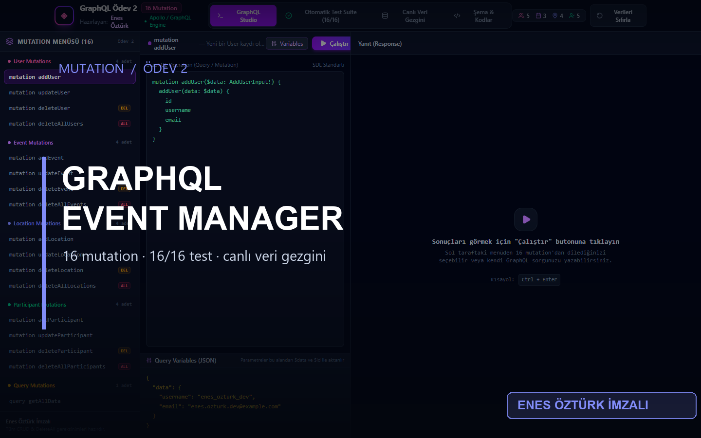
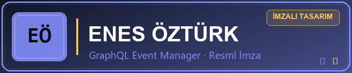
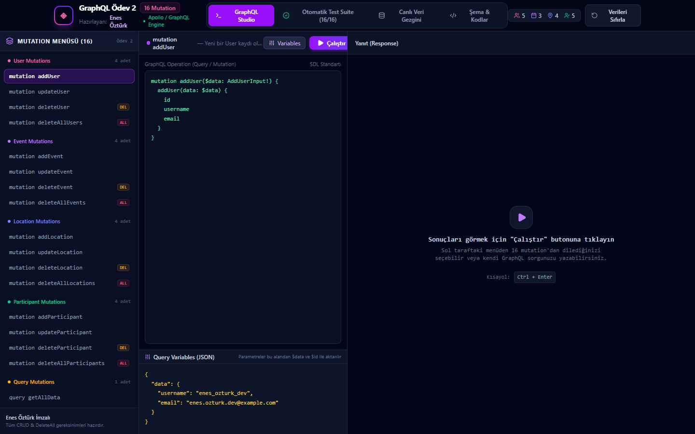
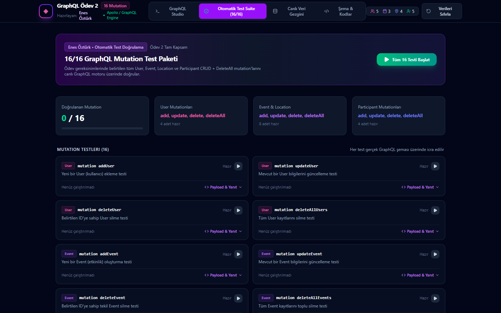
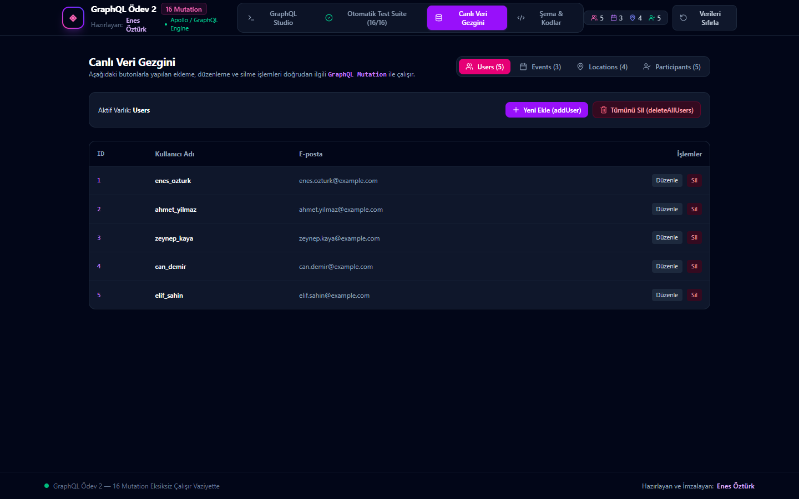

<div align="center">



# GraphQL Event Manager

**Ödev 2 — 16 mutation ve 16/16 geçen otomatik testle etkinlik yönetimi GraphQL çalışması.**

[](https://github.com/EnesBinMalik/graphql-event-manager)
[](https://github.com/EnesBinMalik/graphql-event-manager)
[](https://github.com/EnesBinMalik/graphql-event-manager)
[](https://github.com/EnesBinMalik/graphql-event-manager)
[](https://github.com/EnesBinMalik/graphql-event-manager)
[](https://github.com/EnesBinMalik)



</div>

---

## Hakkında

GraphQL Event Manager, kullanıcı, etkinlik, konum ve katılımcı varlıkları için eksiksiz CRUD operasyonları sunar. 16 mutation tek tek test edilir ve test paneli 16/16 sonucunu canlı olarak gösterir. Veri gezgini tüm varlıkları ilişkileriyle birlikte sunar.

> Bu proje **Enes Öztürk** tarafından tasarlanmış, geliştirilmiş ve imzalanmıştır.

---

## Öne çıkan özellikler

| Özellik | Açıklama |
| --- | --- |
| **16 mutation** | Dört varlık için ekleme, güncelleme ve silme. |
| **16/16 test** | Otomatik test suite tüm mutation'ları doğrular. |
| **GraphQL Studio** | Sorgu ve mutation editörü, değişken paneli. |
| **Veri gezgini** | Varlıkları ilişkileriyle birlikte keşfetme. |
| **Şema & kodlar** | Şema metni ve çözümleyici kaynak kodu. |
| **Sıfırlama** | Veri kümesini başlangıç durumuna döndürme. |

---

## Kapsam

| Ölçü | Değer |
| --- | --- |
| Mutation | 16 |
| Test | 16/16 |
| Varlık | 4 |
| İlişki | Tam |

---

## Galeri







---

## Kurulum

**Gereksinim:** Node.js 20+

```bash
git clone https://github.com/EnesBinMalik/graphql-event-manager.git
cd graphql-event-manager
npm install
npm run dev
```

> Test paneli her mutation'ı gerçekten çalıştırarak sonucu raporlar.

Diğer komutlar:

```bash
npm run build     # Üretim derlemesi
npm run preview   # Derlemeyi önizle
npm run lint      # TypeScript tip kontrolü
```

---

## Teknik mimari

```text
src/graphql/schemaText.ts   Şema tanımı
src/graphql/resolvers.ts    Mutation çözümleyicileri
src/graphql/database.ts     Veri kümesi
src/components/TestSuite.tsx  16 test paneli
src/components/DataExplorer.tsx  Veri gezgini
```

---

## İmza

<div align="center">

[](https://github.com/EnesBinMalik)
[](https://github.com/EnesBinMalik)

**Bu kod, tasarım ve deneyim Enes Öztürk'ün kişisel imzasını taşır.**

© 2026 Enes Öztürk — Tüm hakları saklıdır.

</div>
